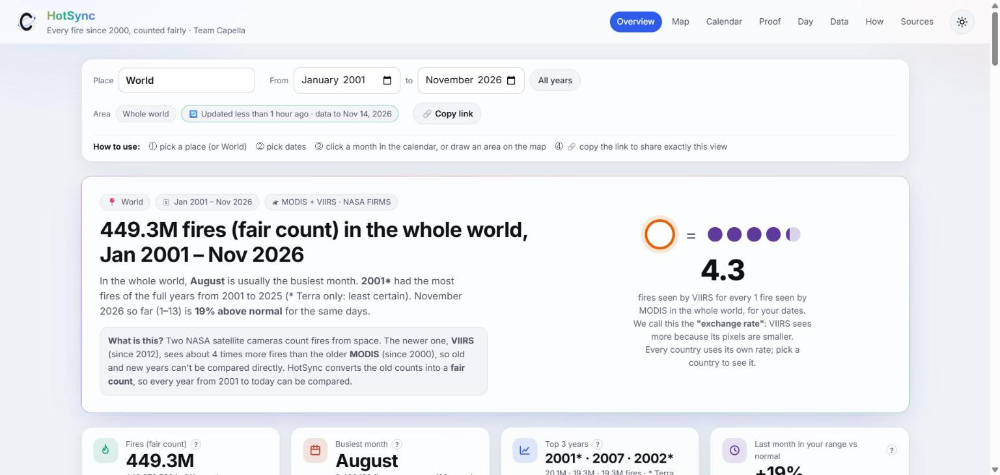

# HotSync · every fire since 2000, counted fairly

Team **Capella** (Tashkent, Uzbekistan) · NASA Space Apps Challenge 2026 ·
Challenge: **"Harmonization of MODIS and VIIRS Hot Spots"**

**Live site:** https://husanxon4407.github.io/hotsync-practice/



## What HotSync is

Two NASA satellite cameras count fires from space:

- **MODIS** (since November 2000) has big pixels (about 1 km) and misses small fires.
- **VIIRS** (since January 2012) has small pixels (about 375 m) and sees about **4 times more** fires.

So if you simply put their numbers next to each other, recent years always look worse than old years.
**HotSync makes the counts fair to compare**: it converts the old MODIS counts into "VIIRS-like" counts
(a **fair count**, or *harmonized* count), for **every country, any area you draw, and the whole world**,
from 2001 to today.

On the website you can:

- pick a country (or **World**) and any dates, or draw an area / type a box on the map;
- read the **fire calendar** (years × months), switch to *MODIS saw*, *VIIRS saw* or *vs normal*;
- see **this month vs normal** (a month still in progress is compared day by day with the same days of past years);
- look at one day, fire **dots for the whole planet on any day since 2000**, **live fires of the last 48 hours**
  (click a dot), and NASA **satellite pictures** (burned land looks reddish in MODIS 7-2-1);
- see the **proof** that the conversion works, the cleaning steps and the honest **limits**;
- **download** the monthly numbers as CSV and **share a link** to exactly what you see.
- **print a one-page fire report** (or save it as PDF) of your place, area and dates, for meetings.

## How it works (the method, in simple words)

1. **Load.** We read NASA FIRMS yearly files: MODIS 2000–2025 and VIIRS (Suomi NPP) 2012–2025, every country
   (~7 GB). The current year comes from the FIRMS API.
2. **Clean.** We keep only vegetation fires (`type = 0`), drop low-confidence detections (MODIS < 30, VIIRS "low"),
   and remove **"always hot" places** (factories, gas flares, power plants): ~1 km squares that are hot in 8+ months of
   a year in 3+ years, or in 10+ months of any one year, plus the 8 squares around each (4,519 places worldwide).
3. **Make fair (the "exchange rate").** In the years when both satellites flew (Feb 2012 – Dec 2025) we compute, for
   each country and each calendar month, **VIIRS ÷ MODIS** for every year, and take the **median** (one strange year
   can't move it). Before July 2002 only one MODIS satellite (Terra) existed, so those months use a separate
   *Terra-only* rate. Countries with very few fires use the world median rate (4.36).
   **Fair count:** before Feb 2012 = rate × MODIS; from Feb 2012 = what VIIRS saw.
4. **Check (the "hide the answer" test).** We learn the rates only from 2015–2025, predict the hidden VIIRS months of
   2012–2014 from MODIS, and compare with the real VIIRS. Whole world: off by **2.2 %** in a typical month,
   correlation **r = 0.986**. Brazil: 3.5 %, r = 0.999. Every country's result is shown on the site.
5. **Keep growing.** A robot (GitHub Action) runs every 2 days: it fetches the newest fires from the FIRMS API, cleans
   them the same way, and updates the current year and the live layer. When Suomi NPP has no data (or only part of
   a day, or after it stopped on 2 Nov 2026) we use NOAA-20 (same camera), adjusted with a factor learned on days when
   both flew (world factor 1.011).

## Run it yourself

```
python -m venv .venv
.venv\Scripts\activate                 # Windows (macOS/Linux: source .venv/bin/activate)
pip install -r requirements.txt

python download_firms.py               # ~7 GB of FIRMS yearly zips (folders in config.py)
python check_data.py                   # are all 40 zips there and OK?
python countries.py                    # once: country borders -> data/countries.geojson
python process_all.py --all            # history 2000-2025 -> web/data/ (about 40 min the first time)
python update_recent.py --backfill 2026-01-01   # the current year (needs FIRMS_MAP_KEY in .env)
python check_all_countries.py          # sanity check of every country file

cd web
python -m http.server 8000             # then open http://localhost:8000
```

`.env` (never committed) holds one line: `FIRMS_MAP_KEY=your_key` (free key:
https://firms.modaps.eosdis.nasa.gov/api/map_key/). On GitHub the same key is the secret `FIRMS_MAP_KEY`.

**Fast loading:** the site downloads under 1 MB on the first visit (World). The month-by-month map squares
(4 MB for World) come later in the background and are only needed for other dates, a drawn area or a square's popup.
`python process_all.py --repack` turns old one-file country JSONs into this two-file form (and checks every file).

**When a year ends** (e.g. 2026): download its yearly FIRMS zips (`download_firms.py`, add the year), run
`process_all.py --all` so it becomes fixed history, and set `HISTORY_END` in `update_recent.py` / `MODIS_YEARS`,
`VIIRS_YEARS` in `process_all.py` to the new year. The robot then continues with the next year.

## Files

| File | What it does |
| --- | --- |
| `config.py` | all folder paths (big data on drive D:, outside git) |
| `download_firms.py`, `check_data.py` | download and check the 40 FIRMS yearly zips |
| `countries.py` | country borders (Natural Earth) with FIRMS names; `assign_country()` |
| `process_all.py` | cleaning, grid, exchange rates, validation, country + world files |
| `update_recent.py` | the robot: current year, NOAA-20 factor, live layer |
| `check_all_countries.py` | checks every country file |
| `.github/workflows/update.yml` | runs the robot every 2 days |
| `web/` | the website (`index.html`, `app.js`, `style.css`, `data/`) |
| `web/data/country/` | two files per place: `<slug>.json` (small, opens the page at once) and `<slug>.cells.gz` (all map squares month by month, packed; loads in the background) |
| `HOTSYNC_PLAN.md`, `PROGRESS.md` | the plan and what was done, step by step |

## Data and sources

- [NASA FIRMS](https://www.earthdata.nasa.gov/data/tools/firms): MODIS Collection 6.1 and VIIRS 375 m active fire
  data (yearly country files 2000–2025, API for the current year: SP and NRT, Suomi NPP, NOAA-20, NOAA-21).
- [FIRMS Archive Download](https://firms.modaps.eosdis.nasa.gov/download/): every single fire dot.
- [NASA GIBS](https://www.earthdata.nasa.gov/engage/open-data-services-software/earthdata-developer-portal/gibs-api):
  satellite pictures (MODIS Terra 7-2-1, VIIRS NOAA-20 true colour) and daily fire-dot layers.
- [Natural Earth](https://www.naturalearthdata.com/): country borders (1:50m). Map tiles: © OpenStreetMap contributors.
- Website: Leaflet 1.9.4, Leaflet-Geoman 2.17.0, Chart.js 4.4.1, PapaParse 5.4.1, Inter font.
  Processing: Python with pandas, NumPy, PyArrow, Shapely, Matplotlib. Colours: ColorBrewer (YlOrRd, RdBu).

We acknowledge the use of data and/or imagery from NASA's Fire Information for Resource Management System (FIRMS)
(https://earthdata.nasa.gov/firms), part of NASA's Land, Atmosphere Near real-time Capability for Earth observations
(LANCE) (https://earthdata.nasa.gov/lance) and NASA's Earth Science Data and Information System (ESDIS).

## Use of AI

The code was written with help from AI (**Claude Code**). The idea, the method choices (cleaning rules, the
"exchange rate" harmonization, the validation, treating every place the same) and the decisions along the way are
the team's.

## Team Capella

Bekzod · Husanxon · Arzima · Munisa · Odinabonu
